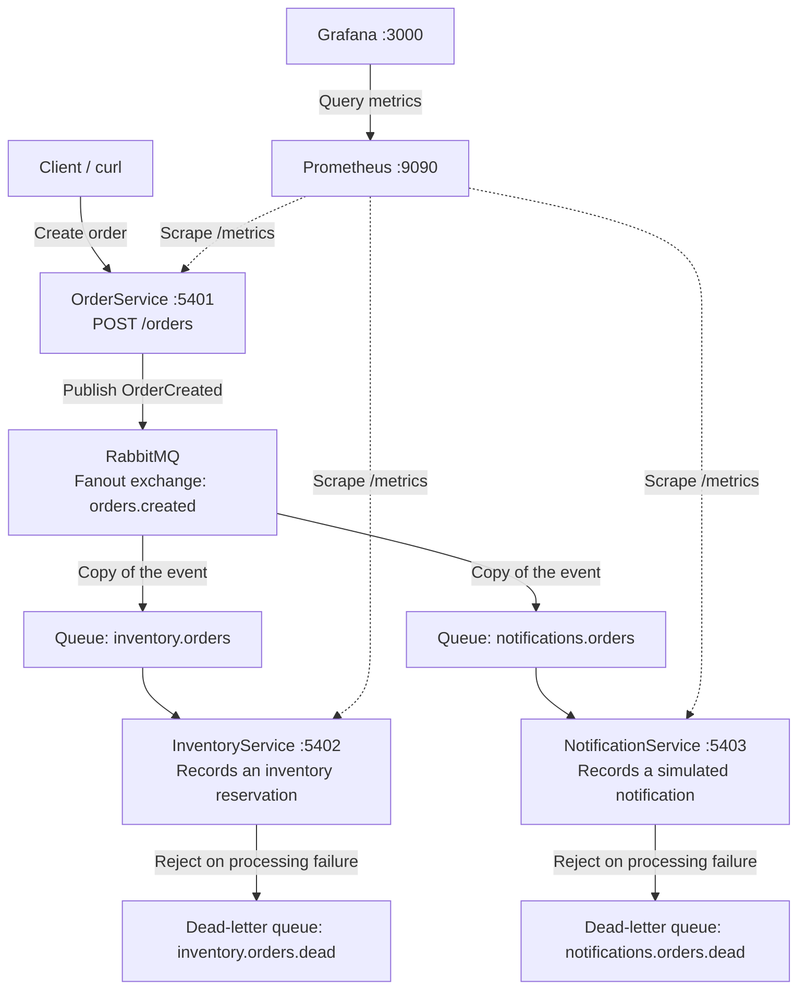

# 04 - Publisher / subscriber with RabbitMQ

Three .NET 10 microservices communicate asynchronously through RabbitMQ. Docker Compose runs the services, broker, Prometheus, and Grafana together.



Each subscriber has its own durable queue, so **both services receive every event**. Multiple instances of the same subscriber would share its queue and divide the work. There are no HTTP calls between the microservices.

- **OrderService** validates an order and publishes an `OrderCreated` event. HTTP 202 means RabbitMQ confirmed publication; subscribers may still be processing it.
- **InventoryService** records a simulated inventory reservation.
- **NotificationService** records a simulated notification. It does not send real email.

## Start everything

Install Docker with Docker Compose and start its engine. From this directory:

```bash
docker compose up --build -d
docker compose logs -f order-service inventory-service notification-service
```

The first build requires internet access for .NET packages and container images. Applications wait for RabbitMQ's health check and retry their initial connection. Each application also exposes `/health` (200 when its RabbitMQ connection/channels are ready, otherwise 503).

| Component | URL | Credentials |
| --- | --- | --- |
| OrderService | http://localhost:5401/orders | — |
| InventoryService | http://localhost:5402/reservations | — |
| NotificationService | http://localhost:5403/notifications | — |
| RabbitMQ management | http://localhost:15672 | `demo` / `demo-password` |
| Prometheus targets | http://localhost:9090/targets | — |
| Grafana dashboard | http://localhost:3000/d/example04-pubsub | `admin` / `admin-demo` |

Ports are bound to localhost. These fixed credentials are for this local example. Grafana provisions its Prometheus data source and the **Microservices / Example 04 - Publisher / Subscriber** dashboard automatically.

## Publish an order

```bash
curl -i http://localhost:5401/orders \
  -H 'Content-Type: application/json' \
  -d '{"productId":"keyboard-01","quantity":2,"customerEmail":"customer@example.com"}'
```

The response contains an `orderId`. After a short delay, both subscriber lists should contain that same ID:

```bash
curl http://localhost:5402/reservations
curl http://localhost:5403/notifications
```

You can also retrieve a specific item with `/orders/{orderId}`, `/reservations/{orderId}`, or `/notifications/{orderId}` on its respective service. Invalid input returns 400; publication failures return 503.

## Observe the flow

Every service exposes `/metrics`. The dashboard shows availability, published orders, unique orders processed by each subscriber, processing rate, failures, and processing latency. Allow at least one 5-second scrape interval after sending an order; rate/latency charts need multiple scrapes.

Useful PromQL queries:

```promql
orders_published_total{job="order-service"}
orders_processed_total{job=~"inventory-service|notification-service"}
sum by (job) (rate(orders_processed_total[1m]))
order_event_failures_total
```

To demonstrate independent subscribers, stop one subscriber, publish an order, and inspect its backlog in RabbitMQ management:

```bash
docker compose stop notification-service
# Publish another order with the curl command above.
curl http://localhost:5402/reservations
docker compose start notification-service
# The notification subscriber drains its queued orders after reconnecting.
curl http://localhost:5403/notifications
```

## Delivery behavior and limits

- The fanout exchange and both queues are declared before orders are accepted, so an offline subscriber's messages can wait in its queue.
- Messages are persistent, queues are durable, and publication uses publisher confirms with a five-second timeout. RabbitMQ data lives in a named volume.
- Consumers use manual acknowledgements and prefetch 1. Invalid or failed events are rejected to `inventory.orders.dead` or `notifications.orders.dead`, avoiding an endless requeue loop. Inspect these queues and application logs to diagnose failures; replay is manual.
- Automatic RabbitMQ connection/topology recovery handles a broker restart after initial connection. Requests during an outage return 503.
- Delivery can occur more than once after a lost acknowledgement. Subscribers deduplicate by order ID **only while that process is running**.
- Orders, reservations, notifications, and deduplication records are in memory and reset when their service restarts. Acknowledged events are not replayed, and metrics counters reset too. This is an event communication example, with no stock database or email provider.
- There is no transactional outbox, persistent inbox, or HTTP idempotency key. A failed/timed-out publication can have an uncertain outcome; repeating a POST creates a new order. A production implementation needs durable business state and idempotency alongside messaging.

## Run services with the SDK instead

Start only infrastructure:

```bash
docker compose up -d rabbitmq
```

With the .NET 10 SDK installed, build all three services with `dotnet build PublisherSubscriber.slnx`, then use three terminals from this directory:

```bash
dotnet run --project OrderService --urls http://localhost:5401
dotnet run --project InventoryService --urls http://localhost:5402
dotnet run --project NotificationService --urls http://localhost:5403
```

The defaults connect to RabbitMQ at localhost using the demo credentials. Override with `RabbitMQ__Host`, `RabbitMQ__Username`, and `RabbitMQ__Password`. The bundled Prometheus configuration targets Compose service DNS names; use the complete Compose stack to monitor the services.

## Stop or reset

```bash
docker compose down
```

Named volumes preserve RabbitMQ messages, Prometheus history, and Grafana state. To intentionally delete all example data:

```bash
docker compose down -v
```

## References

- [RabbitMQ .NET API guide](https://www.rabbitmq.com/client-libraries/dotnet-api-guide)
- [Publisher confirms](https://www.rabbitmq.com/tutorials/tutorial-seven-dotnet)
- [prometheus-net](https://github.com/prometheus-net/prometheus-net)
- [Grafana provisioning](https://grafana.com/docs/grafana/latest/administration/provisioning/)
